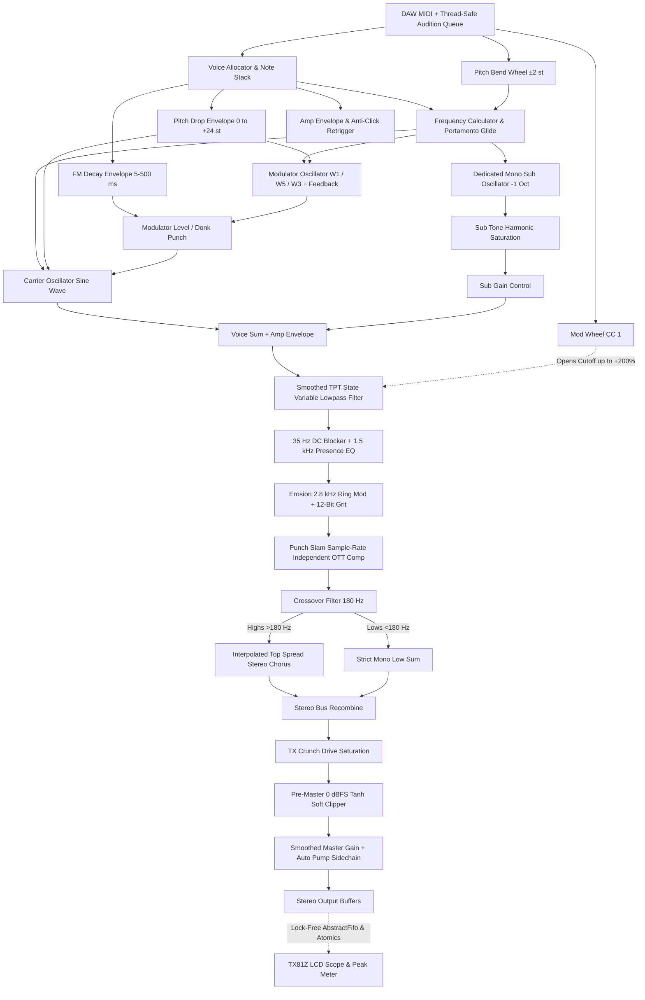

# 🏗️ DSP & Software Architecture — Extasis Donker (v4.0.0)

This document provides a detailed overview of the digital signal processing (DSP) pipeline, thread-safety architecture, and software layers of **Extasis Donker** (Free & Open Source, GPLv3).

---

## 1. High-Level Signal Flow Diagram

---

## 2. Real-Time Thread Safety Architecture

- **Audio Thread (`processBlock`)**:
  - Reads parameters exclusively via cached `std::atomic<float>*` pointers (zero string lookups).
  - Drains GUI audition notes via a non-blocking `juce::SpinLock::ScopedTryLockType` swap.
  - Pushes waveform samples into a fixed-size lock-free `juce::AbstractFifo` ring buffer and updates peak/MIDI telemetry via `std::atomic`.
  - Zero mutexes, zero heap allocations, zero GUI callbacks on the audio thread.
- **GUI Thread (`TX81ZDisplay::timerCallback` @ 30 Hz)**:
  - Safely pops samples from the processor's lock-free `AbstractFifo` and consumes atomic peak/MIDI telemetry.

---

## 3. DSP Modules Breakdown

- **`Source/DSP/DonkSynth.h`**: Voice management, legato portamento, anti-click phase handling, smoothed filter cutoff and master gain, transport-aware Auto Pump, and 250 ms stereo tail handling.
- **`Source/DSP/DonkOscillator.h`**: 2-operator FM engine with continuous W1/W5/W3 waveform morphing, Yamaha-style feedback loop, and phase-aligned sub-oscillator.
- **`Source/DSP/SnappyEnvelope.h`**: Exponential decay envelope generators for FM, Amp, and micro-pitch transient snap.
- **`Source/DSP/StereoProcessor.h`**: Base EQ, Erosion ring-mod/quantizer, sample-rate-independent Punch Slam, 180 Hz mono/stereo crossover with linearly interpolated Top Spread chorus (dynamically sized for up to 192 kHz), drive, and 0 dBFS soft clipper.

---

## 4. GUI & Application Layers

- **`Source/PluginProcessor.h/.cpp`**: JUCE AudioProcessor, APVTS parameter tree, 40-preset factory table, XML user preset serialization, and lock-free telemetry bridge.
- **`Source/PluginEditor.h/.cpp`**: Scalable 700:400 vector rack editor, double-click default reset, hover tooltip routing.
- **`Source/GUI/TX81ZLookAndFeel.h/.cpp`**: Custom hardware rotary knobs, rubberized toggle buttons, and dark/cyan ComboBox & PopupMenu styling.
- **`Source/GUI/TX81ZDisplay.h/.cpp`**: Phosphor dot-matrix LCD with zero-crossing oscilloscope, vertical peak meter, and MIDI LED.
- **`Source/GUI/DonkTriggerButton.h/.cpp`**: Tactile audition logo pad with ±12 semitone vertical pitch drag.
- **`Source/GUI/SavePresetOverlay.h`**: Native scalable modal overlay for saving `.edpreset` files with Return/Escape support.
