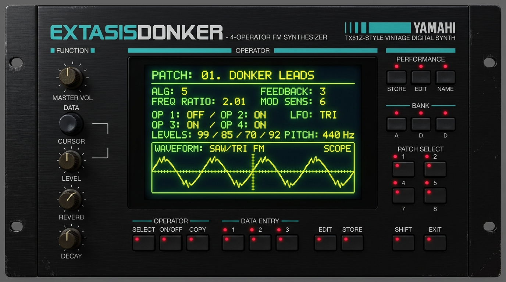

# ⚡ Extasis Donker (v4.0.0 — Free & Open Source)

<p align="center">
  
</p>

<p align="center">
  <strong>The Free & Open-Source FM Donk & Guaracha Bass Synthesizer Workstation</strong><br>
  <em>Inspired by the legendary Yamaha TX81Z (1987), 90s House, and Global Club Culture. Built with JUCE (C++17) for macOS, Windows & Linux.</em>
</p>

<p align="center">
  
  
  
  
</p>

<p align="center">
  
</p>

---

[](https://github.com/laurorobles/ExtasisDonker/actions/workflows/build.yml)

## ✨ Introduction & Philosophy

**Extasis Donker** is a **100% Free & Open Source (GPLv3)** virtual instrument designed exclusively for one purpose: synthesizing the hardest-hitting, club-ready **DONK** and **GUARACHA** basslines. From the iconic *LatelyBass* of the late 80s and the *House Organ Basses* of the 90s, to modern *Guaracha Medallo Punch*, *Aleteo*, *Russian Hardbass*, *UK Bounce*, and *Tech House Slaps* — this plugin is the definitive open-source toolkit for percussive electronic bass.

Standard 4- or 6-operator FM synthesizers are notoriously tedious to program; a slight tweak often destroys the harmonic structure, resulting in dissonant noise. **Extasis Donker solves this by locking every parameter into a mathematically calibrated "Sweet Spot"**. Every knob turn guarantees a snappy, phase-aligned, mix-ready bass that translates from festival line arrays to smartphone speakers. No DRM, no demo limits, no menu diving — just pure, instantaneous low-end impact.

---

## 🌟 Comprehensive Feature Set

### 🎛️ 1. TX81Z-Modeled FM Engine
* **2-Operator Core:** Authentically models the gritty, punchy phase modulation of vintage 80s Yamaha chips.
* **Morphing Waveforms (TX WAVE):** Seamlessly blend between a Pure Sine (`W1`), the legendary Yamaha Half-Sine (`W5` — the secret to house organs), and an aggressive Full-Wave Rectified (`W3`) shape.
* **Velocity Sensitivity (VEL SENS):** Deep velocity-to-modulation routing for expressive, dynamic sequencing.

### ⚡ 2. Transient & Dynamics Processing
* **Pitch Drop Laser Envelope:** Ultra-fast, exponential pitch sweep (0 to +24 semitones) applied directly to the carrier. Perfect for physical "thuds" or classic laser zaps.
* **Auto Pump Sidechain:** Built-in, BPM-synced 1/4-note volume ducking (automatically bypassed when DAW transport is stopped so presets are always auditionable).
* **Punch Slam Compression:** Sample-rate independent upward/downward transient compressor inspired by OTT, optimized to glue the attack phase of bass patches.

### 🎚️ 3. Filter & Harmonic Distortion
* **State-Variable Resonant Filter (LP FILTER):** Smooth lowpass filter sweeping down to 50 Hz with smoothed cutoff transitions and squelchy resonance control.
* **TX Crunch:** Simulates non-linear modulator feedback and analog saturation.
* **Erosion Grit:** Injects a tuned 2.8 kHz ring-modulator + 12-bit quantization layer so sub-bass cuts through on laptop and phone speakers.
* **Pre-Master Soft Clip:** Smooth polynomial tanh tape clipper clamped at 0 dBFS.

### 🌌 4. Sub & Spatial Enhancement
* **Mono-Locked Sub Oscillator:** Dedicated pure sine sub-oscillator strictly locked in mono to prevent club phase cancellation, with its own harmonic warmth (`SUB TONE`).
* **Top Spread (Dimension):** Linearly interpolated modulated stereo chorus applied *exclusively* to frequencies above 180 Hz, supporting sample rates up to 192 kHz.

### 🖥️ 5. Modern UX & Workflow
* **Fully Resizable Vector UI:** Smoothly scale from 350x200 to 1400x800 with locked 700:400 aspect ratio and crisp Retina/4K typography.
* **Dynamic TX81Z Phosphor LCD:** Features a lock-free real-time oscilloscope, integrated **Output Peak Meter** (with peak hold & clip alert), **MIDI Activity LED**, and live hover tooltips for every control.
* **Double-Click Reset:** Double-click any knob to instantly reset it to its default value.
* **40 Curated Factory Presets & Native Save Overlay:** 40 distinct club patches plus a built-in `SavePresetOverlay` with Return/Escape shortcuts.
* **Extasis Audition Pad:** Clickable logo pad with vertical drag pitch transposition (±12 semitones).
* **MIDI Expressiveness:** Pitch Bend wheel (±2 semitones) and Mod Wheel (CC 1) dynamically opening the lowpass filter cutoff up to +200%.

---

## 🔄 What's New in v4.0.0 (Free & Open Source Edition)

- **100% Free & Open Source (GNU GPLv3)**: Removed all licensing gates, serial validation, and 10-minute demo timers.
- **Lock-Free Real-Time Audio Safety**: Replaced audio-thread locks/allocations with `juce::AbstractFifo` for the oscilloscope, a `SpinLock`-swapped MIDI queue for audition triggers, cached atomic parameter pointers, and smoothed filter/master gain.
- **DSP Polish**: Added linear interpolation & 192 kHz dynamic buffer sizing to `Top Spread`, sample-rate-independent `Punch Slam`, fixed Mod Wheel (CC 1) routing, and fixed `Auto Pump` when DAW transport is stopped.
- **GUI & UX Upgrades**: Wired native `SavePresetOverlay`, added integrated LCD Peak Meter + MIDI LED, custom dark/cyan ComboBox styling, double-click knob reset, and fixed all resize scaling issues.
- **40 Distinct Factory Presets**: Expanded and hand-tuned all 40 factory presets with zero duplicates.

---

## 📖 Documentation

- **[MANUAL.md](MANUAL.md)** — Complete User Manual & MIDI CC Map
- **[TECHNICAL.md](TECHNICAL.md)** — DSP & System Specifications
- **[ARCHITECTURE.md](ARCHITECTURE.md)** — Signal Flow & Software Architecture
- **[LICENSE](LICENSE)** — GNU General Public License v3.0

---

## 📥 Free Download (Pre-Compiled Binaries)

Download free pre-compiled installers (**VST3**, **AU**, **CLAP**, and **Standalone**) for macOS (Apple Silicon & Intel), Windows (x64), and Linux (x64):

- **Latest Release:** **[GitHub Releases](https://github.com/laurorobles/ExtasisDonker/releases/latest)**

---

## 🛠️ Building from Source

### Prerequisites
- **CMake 3.15+**
- **C++17 Compiler**: Xcode Clang (macOS), MSVC / Visual Studio 2022+ (Windows), or GCC/Clang (Linux)
- **JUCE 8.x** (automatically fetched via CMake `FetchContent`)

### Build Instructions

```bash
# 1. Clone the repository
git clone https://github.com/laurorobles/ExtasisDonker.git
cd ExtasisDonker

# 2. Configure with CMake
cmake -B build -S . -DCMAKE_BUILD_TYPE=Release

# 3. Build VST3, AU, CLAP, and Standalone targets
cmake --build build --config Release --parallel
```

### Automated Installation
- **macOS**: Double-click `installer/INSTALL_MAC.command` or run `./scripts/install.sh`
- **Windows**: Double-click `installer/INSTALL_WINDOWS.bat`
- **Linux**: Run `./installer/INSTALL_LINUX.sh`

---

## 🤝 License & Contributing

**Extasis Donker** is free software licensed under the **GNU General Public License v3.0** — see the [LICENSE](LICENSE) file for details. Pull requests, bug reports, DSP enhancements, and community preset packs are welcome!

## 👥 Credits

- **DSP Architecture & GUI Development**: Lauro Robles (`@laurorobles`)
- **Label & Music**: [Extasis Records](https://extasisrecords.bandcamp.com)
